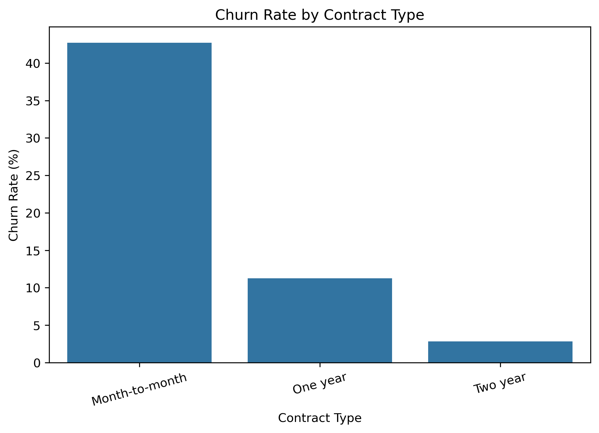
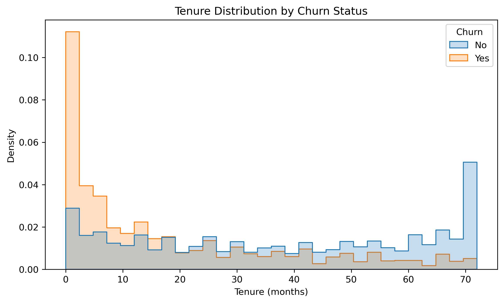
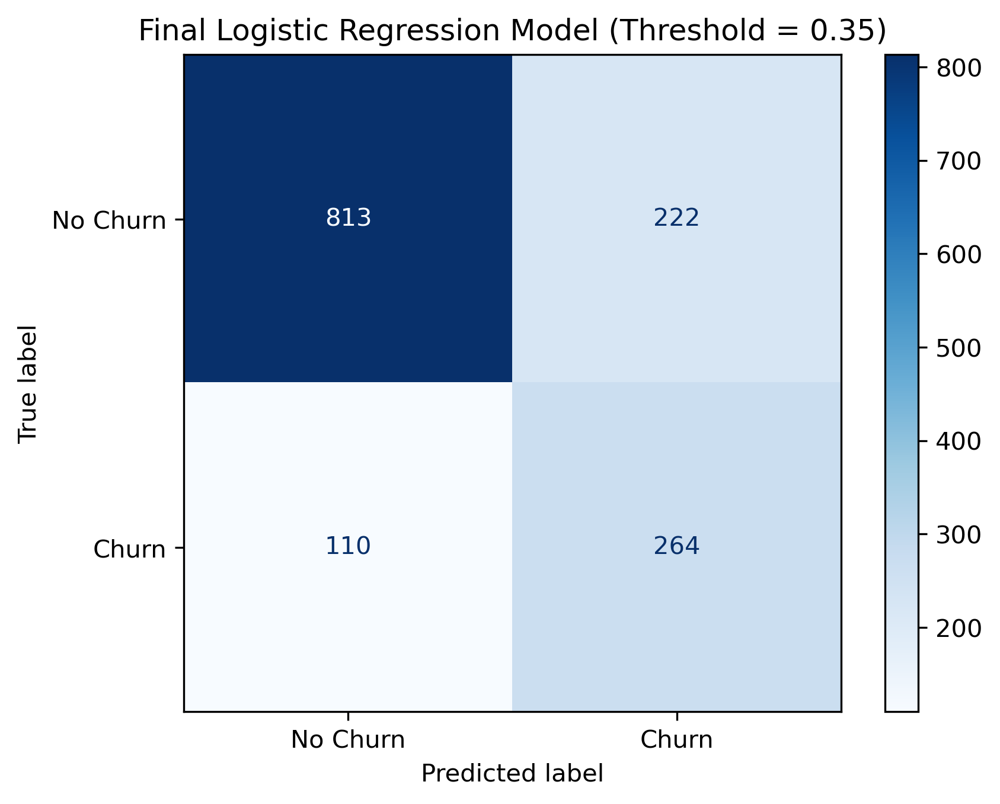
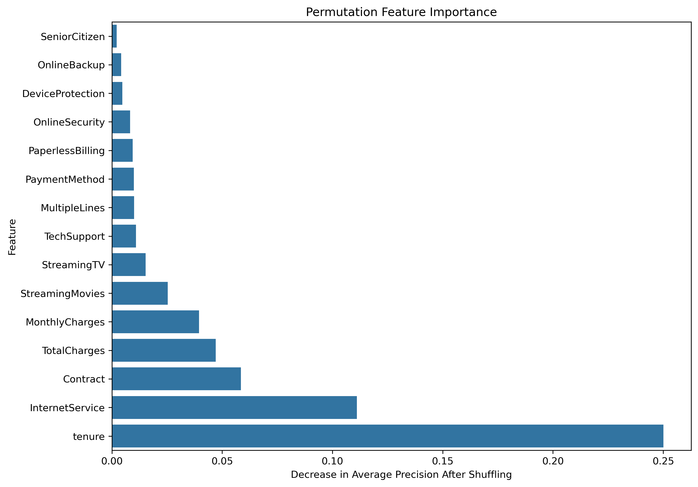
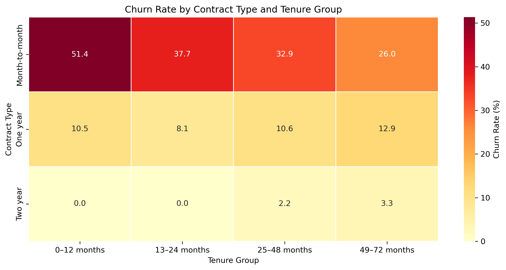

# Customer Churn Prediction

## Project Overview

This project explores customer churn in the IBM Telco Customer Churn dataset and develops machine learning models to identify customers who are likely to leave a telecommunications service.

The goal is to understand patterns associated with customer churn, compare classification models, and investigate how prediction thresholds affect the ability to identify customers at risk of leaving.

**Workflow:** Data Cleaning → Exploratory Data Analysis → Feature Preprocessing → Model Comparison → Threshold Selection → Final Evaluation → Model Interpretation

## Objectives

- Explore customer characteristics and identify patterns associated with churn.
- Clean and prepare the dataset for machine learning.
- Compare Logistic Regression, Decision Tree, and Random Forest models.
- Evaluate model performance using metrics beyond accuracy.
- Select a classification threshold that prioritizes churn detection.
- Interpret important predictive features and communicate findings.

## Dataset

The project uses the **IBM Telco Customer Churn dataset**.

**Source:** IBM Telco Customer Churn sample dataset, as published on Kaggle: [Telco Customer Churn](https://www.kaggle.com/datasets/blastchar/telco-customer-churn). The dataset is used here for educational and portfolio purposes; please refer to the source page for its usage terms.

- **Observations:** 7,043 customers
- **Features:** 21 columns, including the target variable
- **Target variable:** `Churn`
- **Target classes:** `Yes` and `No`

The dataset contains customer demographics, subscribed services, contract information, billing details, tenure, and churn status.

The target variable is encoded as:

- `Yes` → 1
- `No` → 0

The `customerID` column is excluded from model training because it is an identifier rather than a meaningful predictive feature.

## Data Cleaning and Preparation

The following preparation steps were performed:

- Inspected the dataset structure, data types, and missing values.
- Converted `TotalCharges` to a numeric variable.
- Investigated blank `TotalCharges` values, which occurred for customers with zero tenure.
- Replaced the resulting missing values with zero for these customers.
- Separated the predictors from the target variable.
- Split the data into training, validation, and test sets using stratified sampling.

The final split contains:

| Dataset | Observations |
|---|---:|
| Training subset for model comparison | 4,507 |
| Validation set | 1,127 |
| Training data used for final model fitting | 5,634 |
| Test set | 1,409 |

The validation split is created from the original training data. After model selection and threshold selection, the final Logistic Regression model is fitted on the full original training set.

## Exploratory Data Analysis

Exploratory analysis was used to investigate churn patterns across customer characteristics and services.

The analysis focused on:

- Overall churn distribution
- Customer tenure
- Contract type
- Internet service type
- Customer tenure and contract type together
- Differences between customers who churned and those who stayed

### Key EDA Findings

**1. Customer tenure**

Customers with shorter tenure showed higher observed churn rates.

- Tenure of 0–12 months: approximately **47.44%** churn
- Tenure of 49–72 months: approximately **9.51%** churn

**2. Contract type**

Observed churn rates differed substantially across contract types.

- Month-to-month: **42.71%**
- One-year: **11.27%**
- Two-year: **2.83%**

**3. Internet service**

- Fiber optic: **41.89%** churn
- DSL: **18.96%** churn
- No internet service: **7.40%** churn

These results describe associations in the dataset and do not establish that any particular feature causes churn.

## Visualizations

The following figures summarize important patterns from the exploratory analysis and final model evaluation.

### 1. Churn by Contract Type



This visualization compares observed churn patterns across contract types. Month-to-month customers have a substantially higher churn rate than customers with longer-term contracts.

### 2. Tenure Distribution by Churn Status



This plot explores differences in customer tenure between customers who churned and those who stayed.

### 3. Confusion Matrix



The confusion matrix summarizes the final Logistic Regression model's predictions on the test set using the selected classification threshold of 0.35.

### 4. Permutation Feature Importance



Permutation importance measures how predictive performance changes when individual features are randomly shuffled. Tenure, internet service, and contract type were among the most informative features in the validation analysis.

Feature importance does not establish causation, and correlated predictors may share predictive information.

### 5. Churn by Contract Type and Tenure



This heatmap examines how observed churn rates vary across contract types and tenure groups.

The zero observed churn rates in the shortest-tenure groups for two-year contracts should be interpreted cautiously because those groups contain relatively few customers.

## Feature Preprocessing

A preprocessing pipeline was built using Scikit-learn.

**Numerical features**
- `tenure`
- `MonthlyCharges`
- `TotalCharges`

Numerical preprocessing includes median imputation and standardization.

**Categorical features**

Categorical variables are imputed using the most frequent value and encoded using One-Hot Encoding with `handle_unknown="ignore"`.

A `ColumnTransformer` combines the numerical and categorical preprocessing steps. The preprocessing pipeline is fitted as part of each model pipeline to keep the process consistent and avoid fitting preprocessing steps on validation or test data.

## Models Compared

Three classification models were evaluated:

1. Logistic Regression
2. Decision Tree
3. Random Forest

A Dummy Classifier was also used as a baseline.

Because churn is the positive class and the dataset is imbalanced, model comparison considers precision, recall, F1-score, ROC-AUC, and average precision (PR-AUC), rather than relying on accuracy alone.

### Validation Results

| Model | Accuracy | Precision | Recall | F1-score | ROC-AUC | PR-AUC |
|---|---:|---:|---:|---:|---:|---:|
| Logistic Regression | 0.8163 | 0.6966 | 0.5452 | 0.6116 | 0.8482 | 0.6668 |
| Decision Tree | 0.7888 | 0.6667 | 0.4080 | 0.5062 | 0.8364 | 0.6312 |
| Random Forest | 0.8066 | 0.6919 | 0.4883 | 0.5725 | 0.8467 | 0.6558 |

Logistic Regression performed best among the three models on the reported validation metrics and was selected for the final analysis. Its interpretability was also useful for examining how features were associated with predicted churn.

## Classification Threshold Selection

The default classification threshold of 0.50 does not always provide the desired balance between precision and recall.

When the goal is to identify more customers who may churn, lowering the threshold can increase recall, although it may also increase false-positive predictions.

A threshold of **0.35** was selected using validation data to prioritize churn detection while retaining useful precision.

At this threshold, the validation results were:

- Precision: **0.5792**
- Recall: **0.7090**
- F1-score: **0.6376**

The selected threshold was then applied to the final test-set evaluation.

## Final Model Evaluation

The final Logistic Regression pipeline was fitted on the full original training set and evaluated on the held-out test set using the selected threshold of 0.35.

### Test Results

| Metric | Score |
|---|---:|
| Accuracy | 0.76 |
| Precision | 0.5432 |
| Recall | 0.7059 |
| F1-score | 0.6140 |

### Classification Report

| Class | Precision | Recall | F1-score | Support |
|---|---:|---:|---:|---:|
| No Churn | 0.88 | 0.79 | 0.83 | 1,035 |
| Churn | 0.54 | 0.71 | 0.61 | 374 |

The model identifies approximately 71% of customers who churned in the test set. Its churn precision of approximately 54% means that some customers flagged as at risk did not churn.

This trade-off may be useful when the cost of missing a customer at risk of leaving is high, but the appropriate threshold ultimately depends on the business cost of false positives and false negatives.

## Model Interpretation

### Permutation Feature Importance

The permutation importance analysis on validation data highlighted the following features:

- Tenure
- Internet service
- Contract type
- Total charges
- Monthly charges

These features were among the most informative for predictive performance in the fitted model.

### Logistic Regression Coefficients

Logistic Regression coefficients describe changes in the log-odds of churn, conditional on the other features included in the model.

- Positive coefficients are associated with higher churn odds.
- Negative coefficients are associated with lower churn odds.
- Exponentiating a coefficient gives the corresponding odds ratio.
- Numerical features were standardized, so a one-unit increase represents a one-standard-deviation increase.
- Categorical coefficients are interpreted relative to their reference categories.

For example, tenure had a negative coefficient, indicating that greater tenure was associated with lower predicted churn odds when other model features were held constant.

These are conditional associations, not causal effects. Correlated predictors can also make individual coefficients difficult to interpret in isolation.

## Conclusion

This project demonstrates a complete customer churn classification workflow, from data cleaning and exploratory analysis to model comparison, threshold selection, final evaluation, and model interpretation.

The analysis found that tenure, contract type, and internet service were particularly informative for understanding churn patterns in this dataset.

Logistic Regression was selected based on validation performance and interpretability. A classification threshold of 0.35 was used to prioritize recall, resulting in approximately 71% recall on the final test set.

The model can support further investigation into customer retention, but its predictions should be validated against real business outcomes before being used to guide retention campaigns.

## Limitations

- The dataset represents one telecommunications customer population and may not generalize to other businesses.
- The analysis identifies predictive associations, not causal relationships.
- The threshold was selected to prioritize recall; actual business costs were not available to determine an economically optimal threshold.
- The initial exploratory model evaluation involved examining test-set performance before the dedicated validation workflow was completed. Consequently, the test set was not completely untouched during development, and the final test results should be interpreted with some caution.

## Future Improvements

Potential extensions include:

- Evaluating additional classification models.
- Calibrating predicted probabilities.
- Comparing thresholds using an explicit business cost function.
- Investigating explainability with SHAP.
- Testing model performance on new or time-separated data.
- Monitoring model performance and churn patterns over time.

## Tools and Technologies

- Python
- Pandas
- NumPy
- Matplotlib
- Seaborn
- Scikit-learn
- Jupyter Notebook

## Repository Structure

```text
Customer_churn/
├── images/
│   ├── churn_by_contract.png
│   ├── churn_by_contract_type_and_tenure.png
│   ├── logistics_regression_confusion_matrix.png
│   ├── permutation_feature_importance.png
│   └── tenure_dist_by_churnstatus.png
├── customer_churn_pred.ipynb
├── WA_Fn-UseC_-Telco-Customer-Churn.csv
├── README.md
└── requirements.txt
```

## How to Run

1. Clone or download this repository.
2. Install the required dependencies:

   ```bash
   pip install -r requirements.txt
   ```

3. Open `customer_churn_pred.ipynb` in Jupyter Notebook or JupyterLab.
4. Ensure the CSV dataset is in the project directory.
5. Run the notebook cells in order.

## Author

Salwa Onto
LinkedIn : (https://www.linkedin.com/in/salwa-onto-aa5244405)
GitHub : (https://github.com/salwaonto)